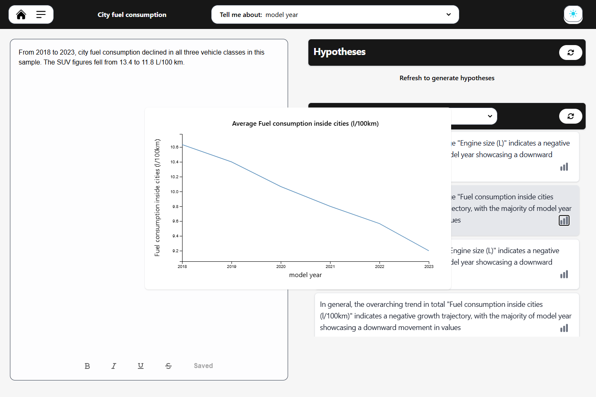

# JourneyAI

JourneyAI is a writing assistant for journalists exploring a dataset. A writer can inspect a statistical finding, open its chart and draft a paragraph in the same workspace. The prototype also uses selected findings and draft text to prompt a language model for hypotheses the writer can investigate.

[Explore the sample dashboard](https://journey-ai-5con.vercel.app/demo) · [Sign in to JourneyAI](https://journey-ai-5con.vercel.app/login) · [Sample vehicle CSV](examples/vehicles.csv)



In the public demo, choose a vehicle class to explore its chart, finding and example hypothesis. The sample covers 18 synthetic records. Average city fuel consumption falls from 10.6 to 9.2 L/100 km between 2018 and 2023. To write a draft or generate a new hypothesis, sign in and upload the sample CSV.

## Inside the dashboard

- **Explore a column.** The Flask analysis code looks for outliers, trends, distributions and associations. The React dashboard renders the results, with D3 bar, line and scatter plots for graphical findings.
- **Develop a story.** A Tiptap editor sits beside the findings. The hypothesis panel sends findings and writing context to a hosted model and records thumbs-up or thumbs-down feedback.
- **Return to a draft.** Upload a CSV, name the story and select **Save** to store its title, text and formatting in MongoDB. Open the story from your homepage to resume writing alongside the same dataset. If another tab has saved a newer revision, the editor keeps your current edits on screen and explains the conflict.

## Run locally

The frontend uses Next.js 14, React 18 and NextAuth. The backend uses Flask, pandas, SciPy, scikit-learn and PyMongo. Both services share a MongoDB database named `db`.

1. Start MongoDB locally or provide a development database. The app creates its collections on first use.
2. For a fresh checkout, copy the [frontend environment template](src/frontend/front-end/.env.example) and [backend environment template](src/backend/.env.example) to a file named `.env` beside each template. Point both connection strings at the same instance. Generate a separate private value for each signing secret using the commands in the templates.
3. To use the online hypothesis model during development, set `GROQ_API_KEY` in `src/backend/.env` and restart Flask. Select a column in the dashboard, click a finding, then click the refresh arrow beside **Hypotheses**. This sends the finding, recent inputs and supplied draft context to Groq. For a year column, the request also includes examples of years recorded in the upload.

Alternatively, leave `GROQ_API_KEY` empty and set `HF_TOKEN` to use Hugging Face Inference Providers with inference credits. Set `HF_MODEL` to override the router model or `HF_INFERENCE_URL` for a dedicated text-generation endpoint.

**Backend.** From the repository root in PowerShell, use Python 3.11 to start Flask in one terminal.

```powershell
cd src/backend
py -3.11 -m venv .venv
.\.venv\Scripts\python.exe -m pip install -r requirements.txt
.\.venv\Scripts\python.exe run.py
```

**Frontend.** In a second terminal, start Next.js using the original development baseline of Node 20.9 and npm 10.1.

```powershell
cd src/frontend/front-end
npm ci
npm run dev
```

Open the app at `http://localhost:3000`. The Flask health route at `http://127.0.0.1:8080/` returns `home`. Register a development account, sign in and upload the [synthetic vehicle CSV](examples/vehicles.csv) to open the dashboard. Select **model year** to explore how fuel consumption changes across the six years of sample data.

**Docker Compose.** To run both application services in containers, set the two MongoDB URIs to an address reachable from inside Docker. With MongoDB running on the Windows host, use `host.docker.internal` in place of `127.0.0.1` in those URIs. Keep the Flask URL browser-accessible. Run this command from the repository root after creating the two environment files.

```powershell
docker compose --env-file src/frontend/front-end/.env -f src/compose.yml up --build
```

## Run online

The frontend runs on Vercel, the Flask API runs on Render, and both connect to the same Atlas database. Groq hosts [gpt-oss-20b](https://huggingface.co/openai/gpt-oss-20b) under its [free-plan limits](https://console.groq.com/docs/rate-limits).

1. Create a [Groq API key](https://console.groq.com/keys) on the free plan.
2. Open the Render backend service, go to **Environment** and save the key as `GROQ_API_KEY`. Also set `MONGO_URI` to the Atlas connection string for the `db` database and set a private `SECRET_KEY`. Deploy the backend with those settings.
3. On Vercel, use `src/frontend/front-end` as the Next.js project root. Set `MONGODB_URI` to the same database, `NEXTAUTH_URL` to the public frontend URL, `NEXTAUTH_SECRET` to its own private key, and `NEXT_PUBLIC_LOCAL_URL` to the public Render URL. Redeploy the frontend to apply the build-time API address.
4. Sign in, upload [the vehicle sample](examples/vehicles.csv), choose **model year**, select a finding, and click the refresh arrow labeled **Generate hypotheses**.

## Check the dashboard

From `src/backend`, run the regression tests with Python 3.11. They use an in-memory MongoDB substitute to check startup, upload permissions, analysis of separate datasets, chart generation and the response when model access is unconfigured.

```powershell
.\.venv\Scripts\python.exe -m pip install -r requirements-dev.txt
.\.venv\Scripts\python.exe -m unittest discover -s tests
```

To check draft saving in a browser, start both services against a disposable development database. The test creates two accounts and uploads a small CSV. It saves formatted text, signs out and back in, checks concurrent edits and verifies that a second account cannot save the first writer's draft. From `src/frontend/front-end`, run the following commands.

```powershell
npx playwright-core install chromium
npm run test:draft
```

The browser test opens `http://localhost:3000` by default. Set `JOURNEYAI_TEST_URL` for a different local port or `JOURNEYAI_BROWSER_PATH` to use an existing Chromium or Edge executable.

With the frontend running, `npm run test:demo` checks the signed-out demo, its vehicle filters, chart data and sample CSV download. The demo reads a bundled copy of the repository sample and can run independently of Flask, MongoDB and the model provider.

## Project materials

The [design document](docs/Group%208%20-%20Design%20Document.pdf) describes the components and interface. The [verification and validation report](docs/Group%208%20-%20Verification%20and%20Validation%20Document.pdf) describes how the team evaluated insights, hypotheses and writing workflows.

JourneyAI began as the McMaster University computer science capstone *Designing Assistant for Data-Driven Stories*. The team was Sarib Kashif, Leo Srayeddin, Omar Zahir, Talha Amjad and Mahad Aziz, supervised by Professor Swati Mishra.
